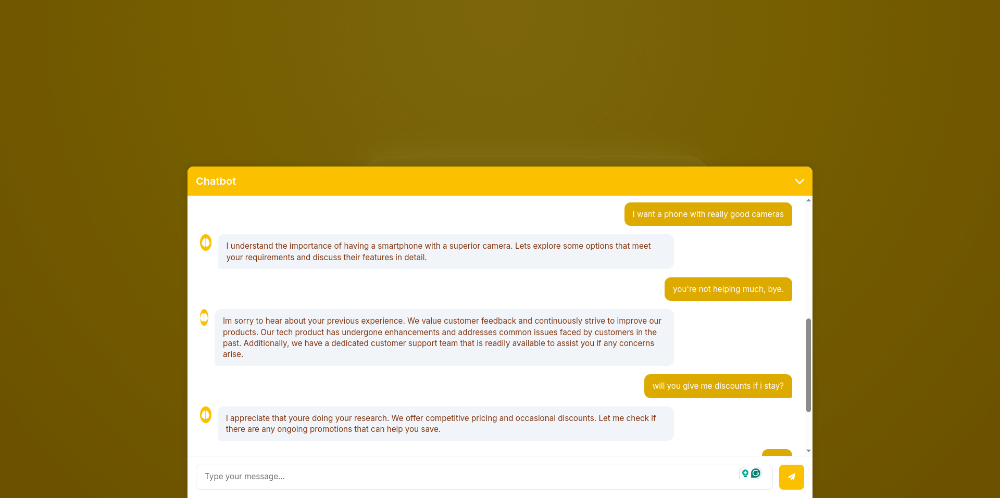

# Sales chatbot

A retrieval-based sales assistant. You type a customer message and it replies with the most suitable answer from a bank of several hundred real salesperson responses. It combines a fine-tuned BERT classifier with semantic search and runs as a Flask web app.

[Video demo](https://drive.google.com/file/d/1wlPwvtLfGfF-v8KR9NLjVRFK_EofYne2/view?usp=sharing)



## How it works

Each incoming message goes through two models, and the app compares their answers.

1. The app lowercases the message and strips out punctuation and numbers.
2. **BERT classifier.** A fine-tuned `bert-base-uncased` model treats every response in the bank as a class and predicts which one fits the message.
3. **Semantic search.** `all-MiniLM-L6-v2` turns the message into an embedding and compares it with precomputed embeddings of every response (`response_embeddings.npy`) using cosine similarity. It keeps the 5 closest matches.
4. **Agreement check.** If BERT's pick is among the 5 semantic matches, the app returns it. If not, it returns the top semantic match. This stops the classifier from returning a confident but off-topic answer.

## Dataset

[goendalf666/sales-conversations](https://huggingface.co/datasets/goendalf666/sales-conversations) on Hugging Face. `label_mapping.json` maps each salesperson response to its class ID.

## Results

<!-- Fill in from the notebook's held-out test set. -->
| Metric | Value |
|---|---|
| BERT top-1 accuracy (test set) | TODO |
| Semantic search top-5 hit rate | TODO |
| How often both models agree | TODO |

## Project structure

```
app.py                   Flask app: model loading, prediction, routes
qa_chat_bot.ipynb        Data prep, BERT fine-tuning, embedding generation
label_mapping.json       Response text to class ID
response_embeddings.npy  Precomputed MiniLM embeddings of every response
templates/, static/      Chat UI
```

## Setup

The trained models are not stored in the repo, so run the notebook first.

1. Run `qa_chat_bot.ipynb`. It saves the fine-tuned BERT model to `saved_model/` and the sentence-transformer to `sent_transf/`.
2. Install the dependencies:
   ```bash
   pip install flask torch transformers sentence-transformers scikit-learn numpy
   ```
3. Start the app:
   ```bash
   python app.py
   ```
4. Open http://127.0.0.1:5000.

## API

`POST /predict`

```json
{ "input": "I'm looking for a laptop for video editing" }
```

Returns:

```json
{ "response": "Salesman: ..." }
```

## Limitations

- Replies come from a fixed bank of responses. The bot can't write new sentences or mention specific products.
- The bot has no memory, so each message is answered on its own.
- The app pads every input to 512 tokens, which makes it slower on CPU than it needs to be.

## Author

Avit Brian Mugisha
